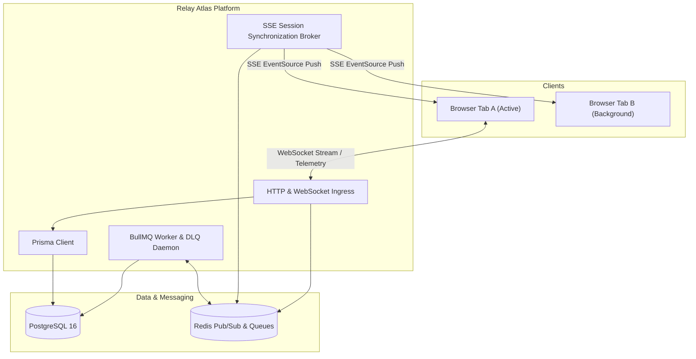

# Project Relay Atlas (`relay-atlas`)

> Distributed workspace synchronization, tenant authorization broker, and real-time backend engine.

## Overview
**Relay Atlas** (Atlas Core) is the foundational backend platform providing distributed tenant isolation, high-speed cross-tab session synchronization, enterprise role authorization, and asynchronous event stream ingestion.



---

## Tech Stack
- **Framework & Runtime:** Next.js 15 (App Router & Edge Handlers) / Node.js 22 LTS
- **Language:** TypeScript 5.6+
- **Database & ORM:** PostgreSQL 16 with Prisma ORM
- **Cache & Pub/Sub:** Redis 7 (ioredis cluster client)
- **Task Scheduling & Worker:** BullMQ
- **Real-Time Transports:** Server-Sent Events (SSE) & WebSocket Gateway

---

## Project Structure
```
relay-atlas/
├── .github/workflows/       # Automated CI build & test workflows
├── docs/
│   ├── architecture/        # RFCs and Architectural Decision Records (ADRs)
│   ├── runbooks/            # Operational DLQ incident recovery playbooks
│   └── onboarding-notes.md  # Architectural handover & blocker register
├── prisma/
│   ├── schema.prisma        # Complete schema (Users, Sessions, Tenants, Audit)
│   └── migrations/          # Versioned SQL migration scripts
├── scripts/                 # Bootstrap & test suite scripts
├── src/
│   ├── auth/                # JWT verification, middleware, and SSE Session Sync
│   ├── config/              # Zod environment validation
│   ├── lib/                 # Prisma, Redis, and logger singletons
│   ├── realtime/            # High-throughput WebSocket Gateway
│   └── workers/             # Telemetry processor & Dead-Letter Queue (DLQ)
├── tests/                   # Jest unit & resilience tests
├── docker-compose.yml       # Local PostgreSQL 16 & Redis stack
├── package.json
└── README.md
```

---

## Getting Started

### 1. Prerequisites
- Node.js >= 22.0.0
- Docker & Docker Compose
- pnpm >= 9.0.0

### 2. Environment Setup
Clone the repository and copy environment configuration:
```bash
git clone https://github.com/CjWrits/Relay-Atlas.git
cd Relay-Atlas
cp .env.example .env
pnpm install
```

### 3. Backing Infrastructure
Spin up local PostgreSQL and Redis containers:
```bash
docker compose up -d
```

### 4. Database Migrations
Apply Prisma migrations to initialize database tables:
```bash
pnpm run db:migrate
```

### 5. Running the Application
```bash
# Start Next.js development server
pnpm dev

# In a separate terminal, run background workers
pnpm run worker:dlq
```

---

## Architectural Decision Records (ADRs) & RFCs
- [RFC-0042: WebSocket vs SSE Unified Streaming](docs/architecture/rfc-event-stream.md)
- [ADR-001: Zero-Downtime Database Concurrency Playbook](docs/architecture/adr-001-zero-downtime-migrations.md)
- [ADR-002: BullMQ Queueing and Retry Strategies](docs/architecture/adr-002-message-queue-architecture.md)
- [DLQ Incident Response Runbook](docs/runbooks/dlq-incident-response.md)
- [Developer Onboarding & Open Technical Risks](docs/onboarding-notes.md)

---

## Security & Concurrency
- Direct modifications to high-volume tables (e.g., `users`, `sessions`) enforce strict lock timeouts (`2000ms`) to avoid blocking primary connection pools.
- Authentication tokens use stateless HMAC-SHA256 with rotation broadcasted through Redis pub/sub.

---

## License
MIT © 2026 CjWrits
