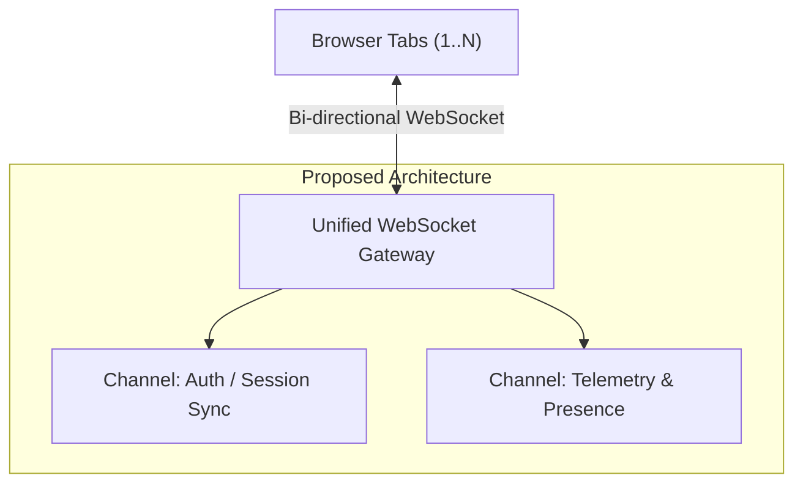

# RFC-0042: Preferring WebSockets over SSE for Atlas Event Streaming

- **Author:** Elena Rostova <elena.rostova@atlas-internal.io>
- **Date:** 2026-10-12
- **Status:** PROPOSED / CONFLICTING
- **Replaces / Challenges:** `src/auth/session-sync.ts` (Arjun Mehta's SSE Implementation)

---

## 1. Context & Motivation
In commit `feat(auth): initial OAuth2 implementation using Server-Sent Events (SSE) for token sync`, Arjun Mehta introduced an HTTP Server-Sent Events (SSE) transport pipeline (`src/auth/session-sync.ts`) to propagate token refreshes and invalidations across browser tabs.

While SSE serves simple unidirectional downlinks cleanly, Project Atlas is expanding into collaborative workspaces requiring:
1. Real-time telemetry reporting from browser clients back to Atlas Core.
2. Low-latency presence and live cursor synchronization (< 40ms round-trip).
3. Bi-directional flow control and binary message serialization (e.g., MessagePack or Protobuf).

## 2. Fundamental Flaws in the Current SSE Approach

### A. Unidirectional Limitation
SSE only streams from server to client. For clients to emit heartbeats, collaborative updates, or telemetry events, they must issue separate HTTP `POST` requests. Under heavy traffic, opening new TCP handshakes and TLS sessions for every client emission introduces significant latency, connection bloat, and server overhead.

### B. Connection Exhaustion in HTTP/1.1 Fallback Environments
In corporate enterprise environments with older proxies or where HTTP/2 is downgraded, browsers enforce a strict limit of **6 concurrent open SSE connections per domain**. If a user opens 5-6 tabs, additional tabs stall completely, breaking auth and live data synchronization.

### C. Fragmentation of Real-Time Infrastructure
Maintaining SSE for authentication sync while building WebSockets for live workspace telemetry creates two disparate streaming stacks, redundant Redis Pub/Sub channels, and fragmented connection monitoring.

## 3. Proposed WebSocket Unified Architecture
We propose replacing `src/auth/session-sync.ts` with a unified WebSocket Gateway (`src/realtime/ws-gateway.ts`):
- Single persistent full-duplex socket per client tab.
- Multiplexed channel protocol (`auth`, `presence`, `telemetry`).
- Support for binary framing to reduce payload overhead by up to 60%.

## 4. Conflict & Action Items
- Deprecate `src/auth/session-sync.ts`.
- Address objections raised by Arjun Mehta regarding WebSocket reconnection complexity and proxy traversal.
- Target migration for Atlas Core v2.5.
